# 🌐 Awesome Generative World Simulation & 3D Sandbox 🎮

  

  
  
  
  
  
  
  

---

## 🧭 Executive Summary & SEO Guide

Welcome to the definitive curated index of **Generative World Simulation**, **Interactive Neural World Models**, **3D Voxel Sandboxes**, **Embodied AI Simulators**, and **Decentralized Spatial Metaverse Platforms**. 

Whether you are building next-generation action-conditioned video generation models (inspired by Google Genie, Decart Oasis, and DIAMOND), researching robotics learning inside GPU physics engines (Genesis, MuJoCo, Habitat-Sim), or launching customizable multiplayer voxel worlds (Luanti/Minetest, Veloren, Godot, Bevy), this repository indexes leading commercial platforms alongside top-tier open-source projects.

### 🔑 Key Search Topics & Categorical Taxonomy
- **🧠 Generative World Models & Neural Simulation**: Diffusion world models, action-conditioned video generation, latent predictive environments, self-supervised spatial imagination.
- **🧱 Voxel Sandboxes & Procedural 3D Engines**: Block-based volumetric world builders, infinite procedural chunk generation, destructible physics, open-source Minecraft alternatives.
- **🤖 Embodied AI & Physics Simulators**: High-throughput GPU parallel rigid-body and soft-body mechanics, robotic manipulation benchmarks, reinforcement learning environments.
- **🌐 Social Virtual Worlds & Decentralized Metaverses**: Browser WebGL/WebXR virtual spaces, spatial audio, creator economies, decentralized identity, self-hosted 3D worlds.

---

## 📑 Table of Contents

- [📊 Sector Overview & Market Dynamics](#-sector-overview--market-dynamics)
- [☁️ SaaS / Hosted & Commercial Platforms](#️-saas--hosted--commercial-platforms)
- [💻 Open-Source GitHub Projects](#-open-source-github-projects)
  - [⭐ Open-Source Ranking Table](#-open-source-ranking-table)
- [📈 Star History](#-star-history)
- [🛠️ How to Contribute](#️-how-to-contribute)
- [⚠️ Disclaimer](#️-disclaimer)
- [💖 Support & Thank You](#-support--thank-you)

---

## 📊 Sector Overview & Market Dynamics

The global market for Virtual Worlds, User-Generated 3D Sandboxes, and Generative World Simulation is estimated at **$38B–$48B+ in 2026**, growing at a **~18%–24% CAGR**. Growth is propelled by user-generated content (UGC) gaming networks, spatial computing hardware, and breakthrough neural generative models running interactive world dynamics in real-time.

### 🏢 Consolidation vs. Fragmentation
- **High Concentration in Consumer UGC (Winner-Take-Most)**: The consumer layer is heavily concentrated around market leaders **Roblox** and **Minecraft (Microsoft)**, which command hundreds of millions of monthly active users and possess network-effect moats in creator monetization.
- **Rapid Fragmentation in Generative AI & Developer Tooling**: In contrast, the developer and research tier is **highly fragmented and rapidly evolving**. Breakthroughs in diffusion-based action-conditioned world models (`DIAMOND`, `WorldPlay2`, `tinyworlds`), sovereign open-source voxel engines (`Luanti`, `Veloren`), and GPU-accelerated robotics physics simulators (`Genesis`, `MuJoCo`, `ManiSkill`) allow independent developers and spatial AI labs to build sovereign worlds free from closed platform lock-in.

---

## ☁️ SaaS / Hosted & Commercial Platforms

*Sorted descending by company valuation / annual revenue scale.*

| Platform | Description | Company Scale (Valuation / Revenue) | Starting Paid Tier | Free Tier / Trial Limit |
| :--- | :--- | :--- | :--- | :--- |
| **[Minecraft Realms (Microsoft / Mojang)](https://minecraft.net)** ⛏️ | Official Mojang-hosted persistent 3D voxel sandbox servers supporting Bedrock cross-play, Java Edition, Marketplace add-ons, and command-block scripting. | **Part of Microsoft Corp.** (~$245B+ annual revenue; ~$3T+ market cap) | **$3.99 / month** (Realms for 2 concurrent players) or **$7.99 / month** (Realms Plus for 10 players + 150+ packs) | **30-Day Full-Access Free Trial** (Includes 10-player Realms Plus server for 30 days; single-player & self-hosted Java/Bedrock servers free with game purchase) |
| **[Crayta Cloud (Unit 2 Games / Meta)](https://unit2games.com)** 🎮 | Collaborative cloud-streamed 3D game creation and sandbox platform built on Unreal Engine allowing real-time multiplayer world editing in browsers. | **Acquired by Meta Platforms** (Part of Meta Platforms' ~$1.5T+ market cap) | **$0 / Free Platform** (Legacy/enterprise technology integrated into Meta's cloud gaming & Horizon creation stack) | **100% Free Access** (Browser-streamed collaborative 3D building and multiplayer sandbox templates at zero cost) |
| **[Roblox Cloud (Roblox Corp.)](https://roblox.com)** 🧱 | Massive user-generated 3D sandbox platform, Luau scripting engine, AI Assistant 3D generator, and global cloud server infrastructure serving 80M+ daily users. | **~$3.5B+ Annual Bookings** (~$30B–$40B+ public market cap on NYSE) | **$0 / Free Hosting** (Roblox retains ~70%–75% platform/store cut on Robux creator payouts; DevEx payouts at 30k+ Robux) | **100% Free Forever** (Unlimited cloud server hosting, Roblox Studio, AI 3D asset/code generation, and global matchmaking at zero server cost) |
| **[The Sandbox (Animoca Brands)](https://sandbox.game)** 🕹️ | Voxel-based 3D gaming metaverse and no-code Game Maker / VoxEdit suite enabling creators to build and monetize voxel experiences. | **Part of Animoca Brands** (~$5.9B peak parent valuation; ~$300M+ group scale) | **$0 / Free Game Maker & VoxEdit** (Virtual LAND parcels sold on secondary markets; creator funds available) | **Forever Free Game Maker & VoxEdit** (Unlimited voxel asset creation, no-code 3D game building, and free experience publishing) |
| **[Rec Room](https://recroom.com)** 🥽 | Cross-platform social VR and flat-screen 3D sandbox creation platform featuring Maker Pen collaborative building, Circuits visual scripting, and Rooms 2.0. | **~$3.5B Peak Valuation** ($294M+ VC funding led by Sequoia/Index) | **$7.99 / month** for Rec Room Plus (monthly token stipend, custom inventions, and creator monetization tools) | **Forever Free Account** (Unlimited cross-platform play, Maker Pen 3D world building, and room publishing across PC, VR, console & mobile) |
| **[Decentraland](https://decentraland.org)** 🌐 | Decentralized browser-based 3D virtual world governed by a DAO, featuring a visual drag-and-drop Builder and TypeScript SDK7 for interactive scenes. | **~$500M–$1.0B+ Ecosystem Market Cap** (DAO-governed virtual world protocol) | **$0 / Free Worlds & SDK** (Personal "Worlds" spaces cost 100 MANA/name; Genesis City LAND parcels trade on open market) | **Forever Free Explorer & SDK7** (Unlimited browser exploration, avatar customization, local scene development, and community events) |
| **[VRChat](https://vrchat.com)** 🎭 | Premier social VR and desktop 3D sandbox universe powered by Unity SDK3 and Udon node/C# scripting for custom interactive worlds and avatars. | **~$300M–$500M+ Est. Valuation** ($95M+ VC funding led by Anthos/Makers Fund) | **$9.99 / month** ($99.99/yr for VRChat Plus; increases favorite avatar slots to 300 & adds photo gallery) | **Forever Free Basic Account** (Unlimited world exploration, full VRChat Creator Companion SDK access, and custom world/avatar publishing) |
| **[Second Life (Linden Lab)](https://secondlife.com)** 🏝️ | Pioneering persistent 3D virtual world and creator economy featuring in-world primitive/mesh building, Linden Scripting Language (LSL), and virtual land. | **~$100M–$200M Est. Scale** (Profitable 20+ year virtual-world pioneer; >$650M+ creator payouts) | **$9.95 / month** billed annually ($11.99/mo monthly for Premium membership + Linden Home parcel) | **Forever Free Basic Account** (Unlimited virtual world access, avatar customization, scripting, and building in public sandboxes) |
| **[Core Games (Manticore Games)](https://coregames.com)** 🚀 | Unreal-Engine-powered UGC 3D game creation and publishing platform providing free multiplayer server hosting, Lua scripting, and kitbashing assets. | **~$100M–$200M Est. Valuation** ($115M+ VC funding led by Epic Games/Benchmark) | **$0 / Free Creator Hosting** (50% revenue share on Perks microtransactions for eligible creators) | **100% Free Forever** (Unlimited Unreal-grade 3D world creation, built-in multiplayer hosting, and asset kitbashing at zero cost) |
| **[Spatial.io](https://spatial.io)** 🎨 | Browser-first 3D social sandbox, virtual gallery, and Unity-powered multiplayer world-hosting platform accessible across web, mobile, and Meta Quest. | **~$100M–$150M Est. Valuation** ($40M+ VC funding led by iNovia/White Star) | **$25 / month** for Spatial+ (up to 50 concurrent users per space, custom branding, and analytics) | **Forever Free Starter Plan** (Unlimited 3D spaces via Unity Creator Toolkit, up to **10–15 concurrent guests**, and browser/VR access) |

---

## 💻 Open-Source GitHub Projects

Explore sovereign, open-source 3D sandbox engines, real-time physics simulators, and generative world model implementations. 

### ⭐ Open-Source Ranking Table

*Sorted descending by GitHub stargazer count. Each star badge links directly to the repository's stargazers page.*

| Project | Stars | License | Category | Description |
| :--- | :---: | :--- | :--- | :--- |
| **[Godot Engine](https://github.com/godotengine/godot)** 🤖 |  | `MIT` | 3D Engine & Sandbox | Multi-platform 2D/3D game engine and procedural world building sandbox with built-in physics, GDScript, and C# support. |
| **[Bevy](https://github.com/bevyengine/bevy)** 🦀 |  | `MIT` / `Apache-2.0` | ECS 3D Sandbox Engine | Refreshingly simple data-driven game engine built in Rust, featuring a modular Entity-Component-System (ECS) ideal for generative simulations. |
| **[Genesis](https://github.com/Genesis-Embodied-AI/genesis-world)** 🌍 |  | `Apache-2.0` | Generative Physics Simulator | Universal physics simulation platform designed for general-purpose robotics, embodied AI, and generative 3D physical world learning. |
| **[MuJoCo](https://github.com/google-deepmind/mujoco)** 🦾 |  | `Apache-2.0` | Contact Dynamics Physics | Multi-Joint dynamics with Contact; Google DeepMind's premier general-purpose physics engine for articulated biomechanics and spatial robotics. |
| **[Luanti](https://github.com/luanti-org/luanti)** ⛏️ |  | `LGPL-2.1+` | Open Voxel Sandbox | Formerly Minetest; the leading open-source voxel game creation platform and infinite-world sandbox with extensive Lua modding API. |
| **[Veloren](https://github.com/veloren/veloren)** 🌲 |  | `GPL-3.0` | Open Voxel World RPG | Multiplayer voxel RPG and procedural world simulator written from scratch in Rust, inspired by Cube World and Dwarf Fortress. |
| **[Terasology](https://github.com/MovingBlocks/Terasology)** 🧱 |  | `Apache-2.0` | Modular Voxel Engine | Highly extensible open-source voxel sandbox engine born from Minecraft-style research, engineered on an extensible component-system architecture. |
| **[Habitat-Sim](https://github.com/facebookresearch/habitat-sim)** 🏠 |  | `MIT` | Embodied AI Simulator | Meta AI's high-performance 3D simulator for training embodied spatial agents in realistic indoor 3D reconstructions at thousands of FPS. |
| **[ManiSkill](https://github.com/mani-skill/ManiSkill)** 🦾 |  | `Apache-2.0` | GPU Robotics Simulator | GPU-parallelized robotics physics simulation engine and interactive manipulation benchmark powered by SAPIEN and PhysX. |
| **[DIAMOND](https://github.com/eloialonso/diamond)** 💎 |  | `Apache-2.0` | Diffusion World Model | *Diffusion As a Model Of eNvironment Dreams*: reinforcement learning agent trained entirely inside an interactive diffusion-generated world model (NeurIPS Spotlight). |
| **[ClassiCube](https://github.com/ClassiCube/ClassiCube)** 🧊 |  | `BSD-2-Clause` | Ultra-Light Voxel Client | Ultra-lightweight custom cross-platform voxel sandbox engine written in pure C from scratch, capable of running on modern and legacy hardware. |
| **[TinyWorlds (Genie Model)](https://github.com/AlmondGod/tinyworlds)** 🧞 |  | `MIT` | Generative World Model | Clean open-source implementation of latent action diffusion world models inspired by DeepMind's Genie for interactive environment synthesis. |
| **[Vircadia Native Core](https://github.com/vircadia/vircadia-native-core)** 🌐 |  | `Apache-2.0` | Decentralized Metaverse | Open-source multi-user decentralized virtual world engine supporting massive concurrency, custom avatars, spatial audio, and user-scripted spaces. |
| **[RaiSim](https://github.com/leggedrobotics/raisimLib)** 🦿 |  | `Academic Free / Custom` | Articulated Robot Physics | High-speed multi-body physics engine designed specifically for legged locomotion, robotic arms, and reinforcement learning in complex physical terrains. |
| **[Hyperfy](https://github.com/hyperfy-xyz/hyperfy)** 🚀 |  | `GPL-3.0` | WebGL 3D Social Sandbox | World building for everyone; customizable real-time multi-user 3D virtual world sandbox built for the open web with WebGL and WebXR support. |
| **[Overte](https://github.com/overte-org/overte)** 🌌 |  | `Apache-2.0` | Open Virtual Worlds | Independent open-source social virtual world platform for desktop and VR, built for sovereign hosting without proprietary vendor constraints. |
| **[WorldPlay2](https://github.com/WorldPlay2/WorldPlay2)** 🎬 |  | `MIT` | Interactive Neural Simulation | Extending real-time interactive world models in control horizons, action conditioning, and long-range temporal coherence for virtual environments. |

---

## 📈 Star History

---

## 🛠️ How to Contribute

We actively welcome contributions from creators, researchers, and engineers! 🤝

1. 🍴 **Fork the repository** on GitHub.
2. 🌿 **Create a new branch**: `git checkout -b feature/add-new-world-engine`.
3. 📝 **Add your entry**: Follow the existing tabular structure (include link, license, transparent pricing or star count, and accurate description).
4. 🚀 **Submit a Pull Request**: Provide a clear explanation of why the tool belongs in this curated collection.

---

## ⚠️ Disclaimer

All product names, trademarks, logos, and brands referenced herein are property of their respective owners. Mention of commercial platforms and open-source frameworks is for informational and educational curation purposes only and does not imply endorsement or affiliation.

---

## 💖 Support & Thank You

A huge thank you to all open-source maintainers, spatial AI researchers, and 3D virtual-world creators who push the boundaries of generative simulation every day! 🌟

If you find this repository valuable:
- ⭐ **Star this repository** to help others discover it.
- 🍴 **Fork and share** with colleagues in spatial computing, AI, and game development.
- ☕ **Support future development & research curation** by buying a coffee on the [GitHub Sponsor Dashboard](https://github.com/sponsors/ishandutta2007)!

  

